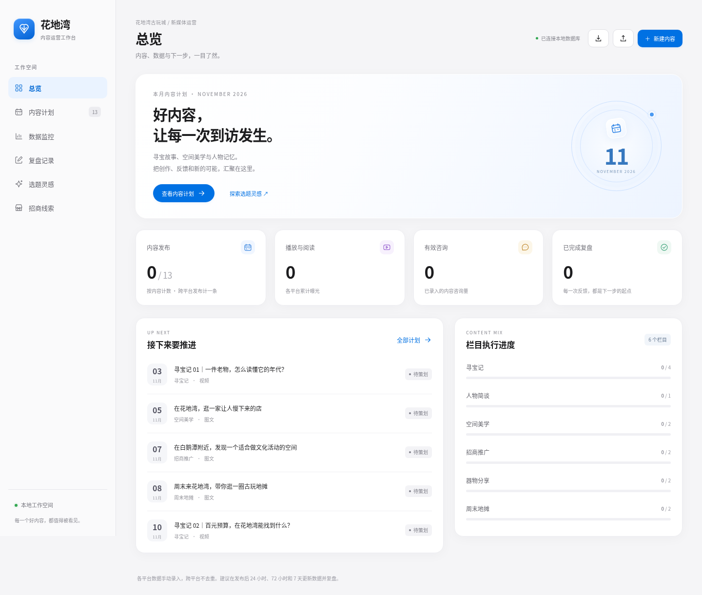
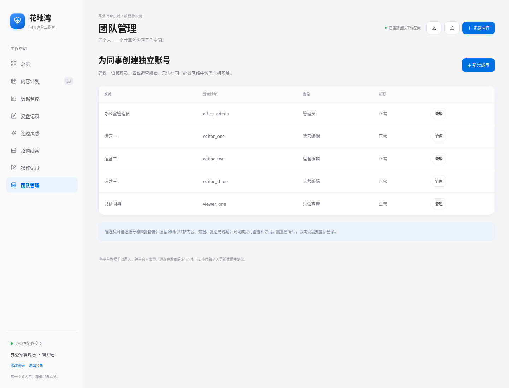
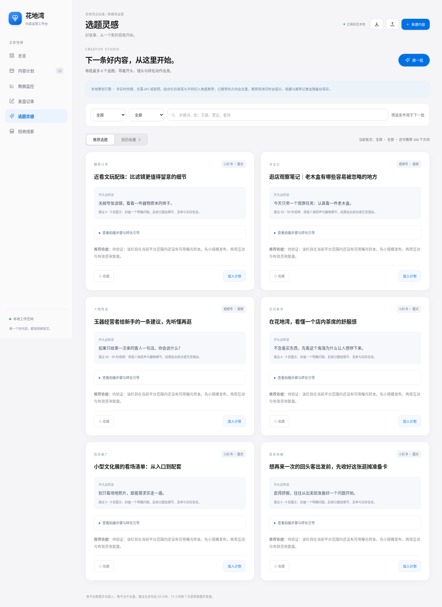

# 花地湾古玩城 · 办公室运营协作台

适合 5 人同办公室使用：一台电脑运行服务，其余同事通过办公网络浏览器登录。保留单机使用方式。Python 3.10+ 标准库即可运行，无第三方依赖。原 OcOn33333 微信小程序保持独立。



## 已有用户升级

本次新增服务端登录、角色和编辑版本保护，**不能只替换 static 文件夹**。先在旧网页导出 JSON 备份，关闭旧服务后，再完整备份原 `data` 文件夹。

下载新版解压到新文件夹，将原 `data` 文件夹复制到新版 `huadi-ops` 内，再启动。程序升级旧数据库并保留已有业务内容；首次在主机本地创建管理员。不包含默认账号或密码。完整步骤见 [5 人办公室部署说明](OFFICE_SETUP.md)。

## 启动与登录

Windows 主机可直接双击 `start-office.bat`，或在项目文件夹运行：

```sh
python server.py --lan
```

其他系统通常使用 `python3 server.py --lan`。默认端口 8765。首次在**主机自己的浏览器**打开 `http://127.0.0.1:8765` 创建管理员。管理员在“团队管理”添加其余 4 人的账号和角色。

同事使用主机的局域网 IPv4 地址访问，例如 `http://192.168.1.25:8765`（换成实际地址），用各自账号登录。主机可通过 `ipconfig` 查看当前办公网 IPv4。使用期间主机保持开机、连接网络，服务窗口可最小化。

不加 `--lan` 时只监听本机：

```sh
python3 server.py
```

账号与所有数据保存在主机 `data/operations.sqlite3`，不会随下载包分发。仅可信办公室内网适用；异地或公网部署需要另行配置 HTTPS。无需把数据库文件放入网络共享目录。

## 团队协作

- **管理员**：维护业务、管理成员、恢复备份；**运营编辑**：维护业务；**只读查看**：查看和导出业务数据。
- 每人独立登录，支持修改自己的密码；管理员可新增成员、变更角色、停用账号或重置密码。
- 保存时检查全局数据版本，其他人已保存时返回冲突，保留草稿并提示刷新后核对。当前为工作区整体版本保护，编辑不同内容也可能触发冲突；不是实时逐字共同编辑。
- 页面定期检查新数据；弹窗编辑和输入期间不会自动替换草稿。
- 操作记录显示用户、时间和动作概述。业务 JSON 备份不包含账号密码或登录会话。



## 日常运营

1. **内容计划**：确认首月 13 条内容的标题、负责人和排期；日期是建议，Excel 未提供日期。
2. **数据监控**：选择视频号、小红书或抖音，录入累计指标和发布链接。每次保留快照，建议发布后 24h、72h、7d 更新。
3. **招商线索**：登记来源内容、需求、跟进阶段、下次联系；咨询指标与线索档案分别维护。
4. **复盘记录**：填写目标、证据、原因和下次动作，再将内容标记已复盘。
5. **选题灵感**：192 个本地创作方向；按栏目、平台、关键词筛选，点“换一批”，每批最多 6 条；附开头、拍摄步骤、结尾引导，支持收藏与加入计划。推荐记录与收藏为团队共享。
6. **备份**：定期导出业务 JSON；仅管理员能恢复，恢复前会自动保留数据库备份到 `data/backups`。恢复业务 JSON 不覆盖成员账号。搬主机前停服务并复制完整 `data` 文件夹。

## 更多选题与抖音接入

本地选题不是实时热榜或联网 AI，不需 API 密钥。已推荐方向及已计划同名标题会去重，库用尽后如实提示；收藏和推荐记录保存在业务数据与 JSON 备份中。旧业务备份没有的选题记录不会凭空恢复。

抖音自动同步尚未接入。网页“数据监控 → 抖音”包含申请步骤：先创建开放平台应用、申请对应读取权限，再让实际运营账号授权。详细边界见 [抖音 API 接入申请](DOUYIN_API.md)。



## 来源与口径

初始计划来自《11月宣传计划.xlsx》：寻宝记视频 4 条、林仕荣人物视频 1 条；空间美学、招商推广、器物分享、周末地摊图文各 2 条。保留 Excel 已定标题，其他标题与排期为建议，初始化月份为 2026 年 11 月。

平台曝光跨账号/平台不去重；互动率为（赞+评+藏+转）/曝光，每千曝光咨询为有效咨询/曝光×1000。未录入不伪造成绩。

## 校验

```sh
python3 tests.py
node --check static/app.js
node tests_topics.js
```

测试使用隔离的临时数据目录。Windows 双击启动脚本需在实际 Windows 电脑上使用；浏览器访问仍取决于办公室网络与主机防火墙设置。
